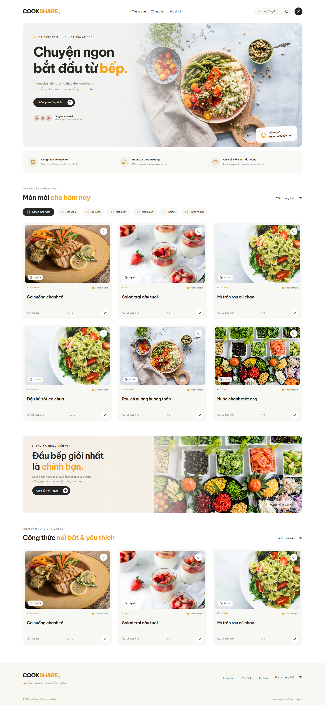

# CookShare · Nấu bằng đam mê, chia sẻ bằng trái tim

Website chia sẻ công thức với **React 19 + TypeScript, Express 5 + TypeScript và MySQL 8**. Trang chủ tông trắng kem/cam, khám phá, chi tiết món ăn, tài khoản, hồ sơ, quản lý công thức và dashboard admin đều dùng API/MySQL thật. Không dùng dữ liệu món ăn giả trong frontend.



## Mở web trên máy hiện tại

**http://localhost:3000/** là giao diện; `/api/v1/recipes` là JSON dành cho lập trình. Bản local đã được cấu hình riêng trong `backend/.env` (không commit). Nếu server dừng, chạy từ gốc dự án:

```powershell
powershell -ExecutionPolicy Bypass -File scripts/start-local.ps1
```

Script tái sử dụng Node portable/MySQL instance đã chuẩn bị trên máy này, hoặc Node đã cài trong PATH. Nếu cần build lại sau sửa code, chạy các lệnh build bên dưới và khởi động lại backend. Script không tự tạo database mới hoặc thay thông tin cấu hình của bạn.

## Chức năng

- Đăng ký, đăng nhập, đăng xuất có thu hồi phiên; hồ sơ, bio, avatar; đổi mật khẩu.
- Thêm/sửa/xóa công thức của mình, upload ảnh thật, nguyên liệu/định lượng, bước nấu, xem trước trước khi đăng. Admin quản lý mọi công thức.
- Tìm tên món/nguyên liệu; lọc danh mục, độ khó, thời gian; sắp xếp mới nhất/yêu thích/đánh giá; phân trang ở backend và UI.
- Yêu thích lưu MySQL theo tài khoản; đánh giá 1–5 sao có cập nhật; bình luận thêm/sửa/xóa với kiểm tra chủ sở hữu.
- Dashboard lấy số liệu từ database, biểu đồ hoạt động, user role/khóa tài khoản, danh mục/nguyên liệu, kiểm duyệt và quản lý bình luận; tìm kiếm/lọc/phân trang.
- Loading skeleton, empty/error state, toast, modal xác nhận xóa; responsive desktop/tablet/mobile.
- Seed **21 công thức tiếng Việt**, 6 danh mục và nguyên liệu; chạy lại không nhân đôi.

`member` trong DB tương ứng USER; `admin` tương ứng ADMIN. Register không được tự gán quyền. Member được thêm nguyên liệu mới để viết công thức; chỉ admin sửa/xóa nguyên liệu và quản lý danh mục. Không thể xóa taxonomy đang được tham chiếu.

## Docker Compose

Yêu cầu Docker daemon đang chạy, Compose v2:

```powershell
Copy-Item .env.example .env
# Sửa toàn bộ mật khẩu, JWT_SECRET và CORS_ORIGIN theo môi trường.
docker compose -f docker-compose.yml -f docker-compose.monitoring.yml --profile tools up -d --build
docker compose run --rm seed
```

Web: **http://localhost:8080** · phpMyAdmin: `http://localhost:8081` · Grafana: `http://localhost:3001` · Prometheus: `http://localhost:9090`. Có thể bỏ file monitoring và profile tools nếu chỉ cần web/API/DB. Đăng nhập web seed bằng `admin@cookshare.local` và SEED_ADMIN_PASSWORD do bạn đặt; Grafana dùng `admin` và GRAFANA_ADMIN_PASSWORD. Không có mật khẩu production mặc định.

MySQL data/uploads/metrics/logs dùng volume. Migration có khóa và lịch sử, chạy trước API. Runtime DB user chỉ có quyền CRUD trên schema; tài khoản migration tách riêng. Xem [triển khai, bảo mật và LogQL](docs/DEPLOYMENT.md), đặc biệt khi nâng cấp volume cũ.

## Chạy development không dùng Docker

Yêu cầu Node.js **22.16+**, npm, MySQL **8.0.16+**. Tạo schema và tài khoản development bằng MySQL administrator, thay mật khẩu ví dụ:

```sql
CREATE DATABASE cookshare CHARACTER SET utf8mb4 COLLATE utf8mb4_unicode_ci;
CREATE USER 'cookshare_dev'@'localhost' IDENTIFIED BY 'replace-this-development-password';
GRANT ALL PRIVILEGES ON cookshare.* TO 'cookshare_dev'@'localhost';
```

Tài khoản development cần DDL để chạy migration. Production dùng tài khoản tách riêng do Docker bootstrap cấu hình.

```powershell
Copy-Item .env.example backend/.env
# Sửa backend/.env: DB_HOST=localhost, DB_PORT=3306, DB_USER=cookshare_dev,
# DB_PASSWORD tương ứng; DB_NAME=cookshare; đặt JWT_SECRET và SEED_ADMIN_PASSWORD.
cd backend
npm ci
npm run db:migrate
npm run db:seed
npm run build
cd ../frontend
npm ci
npm run build
cd ../backend
npm start
```

Mở **http://localhost:3000/**. Express phục vụ frontend đã build từ `frontend/dist`. Nếu muốn hot reload, chạy `npm run dev` tại backend và frontend ở hai terminal; Vite tại `http://localhost:5173` proxy `/api` và `/uploads` về backend. File `.env` tại gốc dành cho Compose, `backend/.env` dành cho local. Restart backend sau khi đổi code/config.

## Kiểm thử

```powershell
cd backend
npm ci
npm run build
npm test
```

Mặc định các integration tests DB bị skip. Để chạy toàn bộ, tạo **database riêng có tên kết thúc `_test`**, cấp quyền cho user test và đặt env:

```powershell
$env:NODE_ENV='test'
$env:DB_NAME='cookshare_test'
$env:DB_HOST='127.0.0.1'
$env:DB_PORT='3306'
$env:DB_USER='cookshare_test_user'
$env:DB_PASSWORD='your-test-db-password'
$env:JWT_SECRET='your-test-secret-with-at-least-32-characters'
$env:SEED_ADMIN_PASSWORD='your-test-admin-password'
$env:RUN_DB_TESTS='1'
npm run db:migrate
npm run db:migrate
npm run db:seed
npm run db:seed
npm test
```

Không trỏ tests vào database có dữ liệu cần giữ. Tests tạo/xóa dữ liệu kiểm thử và kiểm tra guard `_test`. Để test trình duyệt, chạy website trước:

```powershell
cd frontend
npm ci
npx playwright install chromium
$env:BASE_URL='http://localhost:3000'
$env:E2E_ADMIN_PASSWORD='your-local-seed-admin-password'
npm run test:e2e
```

Trên máy có Chrome có thể dùng `$env:E2E_CHROME='1'` thay cài Chromium. Báo cáo tại `frontend/playwright-report`; screenshots ở `frontend/test-results`. Browser tests tạo tài khoản thử và upload vào DB được chỉ định bởi server; chạy với môi trường development/test riêng. Không dùng trên production. Workflow GitHub Actions chạy backend/MySQL và browser tests; workflow stack kiểm tra Docker/monitoring.

Kết quả đã thực chạy và giới hạn: [verification](docs/verification.md). Trạng thái từng nhóm chức năng: [FEATURE_CHECKLIST](docs/FEATURE_CHECKLIST.md). Hướng dẫn endpoint: [API](docs/api.md).

Báo cáo kỹ thuật: [PDF 10 trang](docs/CookShare-report.pdf), [nguồn HTML để điền trang bìa](docs/report.html). Điền họ tên/MSSV/lớp trước khi nộp; `node scripts/export-report.mjs` xuất lại PDF.

## Cấu trúc

```text
frontend/      React, pages/components/services/types, ảnh local, browser tests, Dockerfile
backend/       Express routes/controllers/services/repositories/middleware/config, tests, Dockerfile
database/      migrations, dữ liệu seed, bootstrap DB users
nginx/         reverse proxy và static frontend, security headers
monitoring/    Prometheus, Grafana dashboard/provisioning, Loki, Alloy
.github/       CI backend/browser và Docker stack smoke
scripts/       mở web local, kiểm tra stack
docs/          API, deployment, checklist, kết quả kiểm tra, ảnh minh chứng
```

Source TypeScript nằm trong `src`; `dist` là output build và không commit. Sửa source rồi build lại. Ảnh seed là stock từ Unsplash và có thể tái sử dụng giữa các công thức; ảnh người dùng upload lưu thành WebP trên ổ đĩa, URL lưu MySQL. Không có email reset mật khẩu hay refresh token trong phạm vi hiện tại.
